<b>the safety layer for agentic finance on Robinhood Chain (chain 4663).</b> the check an AI agent calls before it buys, signs or pays. chain facts, not advice.

<a href="https://t0ll.xyz">t0ll.xyz</a> · <a href="https://t0ll.xyz/agents/mcp">remote MCP</a> · <a href="https://x402.t0ll.xyz">x402 facilitator</a> · <a href="https://x.com/Tollxyz_">X @Tollxyz_</a> · ERC-8004 agent #20030

### live now

| | |
|---|---|
| **x402 facilitator** | [x402.t0ll.xyz](https://x402.t0ll.xyz) · USDG on Robinhood Chain · `exact` (EIP-3009 and Permit2), `upto`, escrow, batch · every payee checked against the seller's ERC-8004 agent wallet (ERC-8478) · outside sellers settling since 12 Nov |
| **launch a paid agent** | [x402.t0ll.xyz/x402/launch](https://x402.t0ll.xyz/x402/launch) · 11 templates, ERC-8004 identity minted, payout wallet bound, listed in Discover · free test launch |
| **Hookr** | live app integrator: every call Hookr's MCP builds is checked by `check_tx` before it is signed · [hookr.fun/integrations](https://hookr.fun/integrations) |
| **Hermes Agent** | `hermes plugins install toll` · in the Hermes plugin catalog |

### repos

| repo | what |
|---|---|
| [toll-plugins](https://github.com/t0ll-xyz/toll-plugins) | SDKs (JS, Python) + plugins: Coinbase AgentKit, Vercel AI SDK, LangChain, Mastra, ElizaOS, guard |
| [toll-mcp](https://github.com/t0ll-xyz/toll-mcp) | the MCP server: 28 tools, remote at `https://t0ll.xyz/mcp`, no auth |
| [toll-agent-templates](https://github.com/t0ll-xyz/toll-agent-templates) | 11 ready AI agent templates that sell over x402 in USDG, ERC-8004 identity, settled by Toll |
| [toll-x402-examples](https://github.com/t0ll-xyz/toll-x402-examples) | sell or buy an API for USDG on Robinhood Chain with x402 |
| [toll-allow](https://github.com/t0ll-xyz/toll-allow) | single-use ALLOW tickets + the contracts below (Solidity, Foundry) |
| [toll-launch-check](https://github.com/t0ll-xyz/toll-launch-check) | Uniswap v4 hook that refuses buys in bundled launches, read from the ERC-8470 registry |

### on Robinhood Chain

source verified on Sourcify (exact match), no owner, no admin.

| contract | address |
|---|---|
| TollAllowEnforcer (MetaMask delegation caveat) | [`0x6290…fdb5`](https://robinhoodchain.blockscout.com/address/0x6290dfc474f566b3bf612ad78e9dd3890473fdb5) |
| TollGateHook (Uniswap v4 swap gate) | [`0x0832…4080`](https://robinhoodchain.blockscout.com/address/0x08324e1aDeC7a4047D2DA692d02B891179B14080) |
| TollAllowModule (ERC-7579 module) | [`0xa869…72fd`](https://robinhoodchain.blockscout.com/address/0xa86955745ff2caffed94ee3c363fd86091a972fd) |
| TollAssert (post-trade checks) | [`0x7623…e1b1`](https://robinhoodchain.blockscout.com/address/0x7623a849b2c5fa6f6765163bf4bf66aef16fe1b1) |

### standards

ERC drafts at [ethereum/ERCs](https://github.com/ethereum/ERCs): ERC-8470 Token Launch Observations ([#2121](https://github.com/ethereum/ERCs/pull/2121)), ERC-8478 x402 Payee Verification ([#2132](https://github.com/ethereum/ERCs/pull/2132)), ERC-8481 Agent Pre-Sign Risk Report ([#2134](https://github.com/ethereum/ERCs/pull/2134)). all running in Toll today.

contact: T0llxyz@outlook.com
